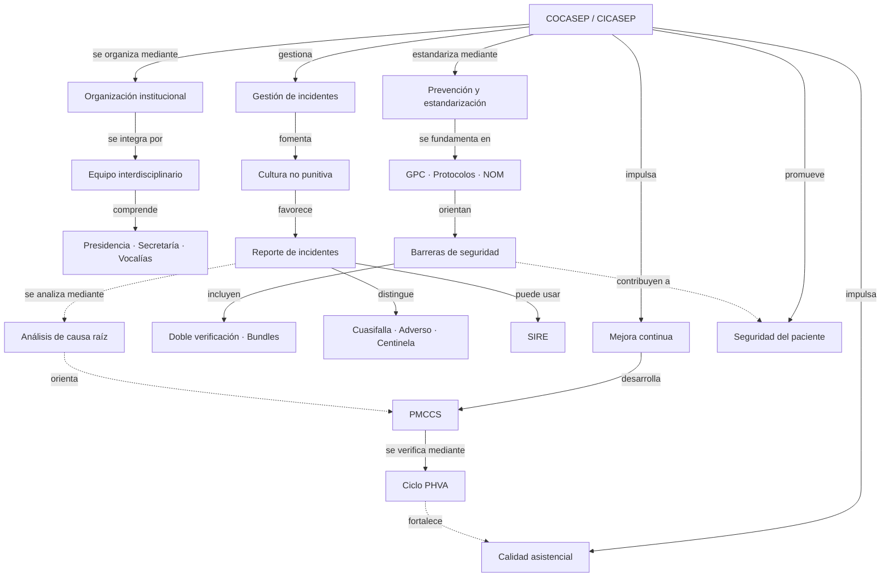

# Mapa conceptual propuesto — jerarquía y relaciones transversales

> **Borrador de apoyo.** Debe ser revisado y reelaborado personalmente antes de cualquier entrega, por la restricción de IA indicada en la rúbrica.

## Reglas de diseño para la versión final
1. **Concepto central arriba**; cuatro ejes en el segundo nivel; conceptos específicos debajo.
2. **Lectura descendente**: del comité a sus funciones, instrumentos y resultados.
3. **Palabras de enlace en todas las relaciones**, incluyendo las transversales.
4. **Líneas continuas y flechas legibles**, sin cruces que oculten texto ni enlaces desconectados.
5. **Nodos breves**: términos, no párrafos. Ejemplos de NAV, BACVC e IVU-SAD en una sola rama.
6. **Jerarquía visible** con tamaños y colores sobrios; tipografía de alto contraste, márgenes y alineación constantes.
7. **Bibliografía y citas verificadas** en un pie o apartado separado, sin ocupar el espacio de las proposiciones.
8. **Formato de impresión** A3 horizontal como propuesta técnica; confirmar requisitos de entrega del docente.

## Diagrama de referencia (Mermaid)

## Verificación de enlaces
Las flechas continuas describen **jerarquías**. Las punteadas muestran **relaciones transversales** entre ramas. Cada flecha incluye una expresión verbal que permite leer una proposición completa. El diseño gráfico final debe mantener esa diferencia visual.

## Referencias
Consultar `conceptos-unificados.md` para referencias de las diapositivas, limitaciones y validaciones pendientes.
