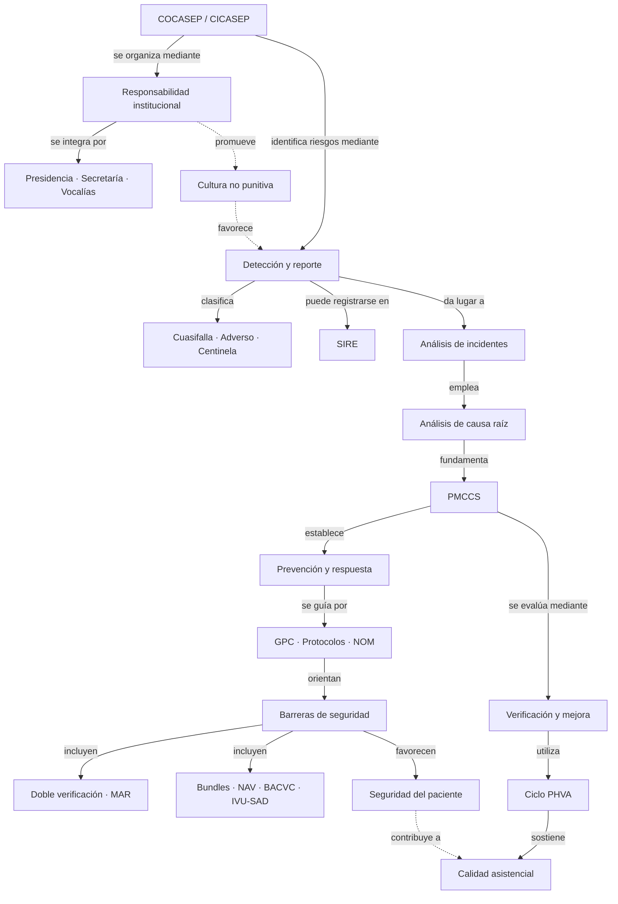

# Mapa conceptual — Versión Alumno B

> Variante de estudio basada en el mismo contenido unificado. **No es una entrega académica lista para presentar**: la rúbrica indica que trabajos con más del 20 % de IA serán anulados. La autoría, las referencias y las conexiones deben revisarse y reelaborarse personalmente con el docente.

## Enfoque diferenciador
Esta versión sigue la **secuencia de gestión de la seguridad**: establecer responsabilidades → identificar y clasificar incidentes → analizar causas → implementar medidas → verificar resultados. La versión A prioriza cuatro ejes funcionales. Ambas comparten el tema y la fuente, pero no la misma organización.

## Jerarquía y proposiciones
| Concepto de origen | Palabra de enlace | Concepto de destino |
|---|---|---|
| COCASEP / CICASEP | coordina | calidad y seguridad del paciente |
| Comité | se integra por | presidencia, secretaría técnica y vocalías |
| Comité | identifica mediante | reporte de incidentes |
| Reporte de incidentes | clasifica | cuasifallas, eventos adversos y eventos centinela |
| Reporte de incidentes | puede registrarse en | SIRE |
| Incidentes | se investigan con | análisis de causa raíz |
| Análisis de causa raíz | fundamenta | plan de mejora PMCCS |
| PMCCS | implementa | acciones correctivas y preventivas |
| Acciones preventivas | incluyen | guías, protocolos y bundles |
| Barreras de seguridad | incluyen | doble verificación independiente |
| Doble verificación | protege durante | administración de medicamentos de alto riesgo |
| Bundles | contribuyen a prevenir | infecciones asociadas a la atención |
| PMCCS | se evalúa mediante | ciclo PHVA |
| Cultura no punitiva | favorece | reporte de incidentes |
| Medidas preventivas | favorecen | seguridad del paciente |
| Ciclo PHVA | sostiene | mejora continua de la calidad |

## Mermaid — secuencia principal y relaciones transversales

## Indicaciones de composición para imagen / PDF
- Formato A3 horizontal, blanco con verde institucional, azul y acentos discretos; alto contraste y márgenes amplios.
- Concepto central arriba; flujo de gestión en cinco fases numeradas, de izquierda a derecha o en cascada.
- Conectores con verbos cortos legibles; conexiones transversales punteadas.
- Nodos con palabras clave, no párrafos ni ejemplos largos.
- Bibliografía verificada en zona inferior, sin inventar metadatos.
- Sin QR ficticio: SIRE solo como concepto si no se dispone del QR real.

## Bibliografía y revisión
Las fuentes bibliográficas originales se recogen en `../conceptos-unificados.md` y necesitan comprobación de vigencia y formato APA/Vancouver. La imagen generada en la conversación es una **propuesta ilustrativa** y no garantiza fidelidad exacta de cada proposición; el Mermaid es la referencia textual revisable.
