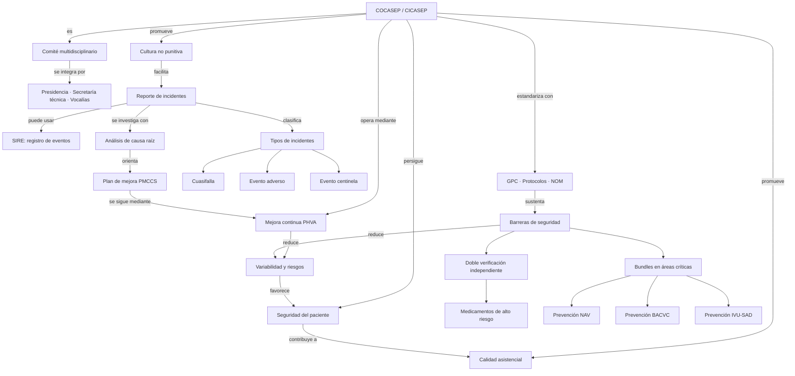

# Mapa conceptual — Calidad y seguridad del paciente

El diagrama organiza las relaciones explícitas e implícitas del material. Las etiquetas de los enlaces explican el vínculo entre conceptos.

## Lectura del mapa
El comité articula la prevención (guías y barreras) con la respuesta a incidentes (reporte, clasificación, análisis de causa raíz y plan de mejora). El ciclo PHVA conecta las medidas correctivas con su verificación y estandarización.